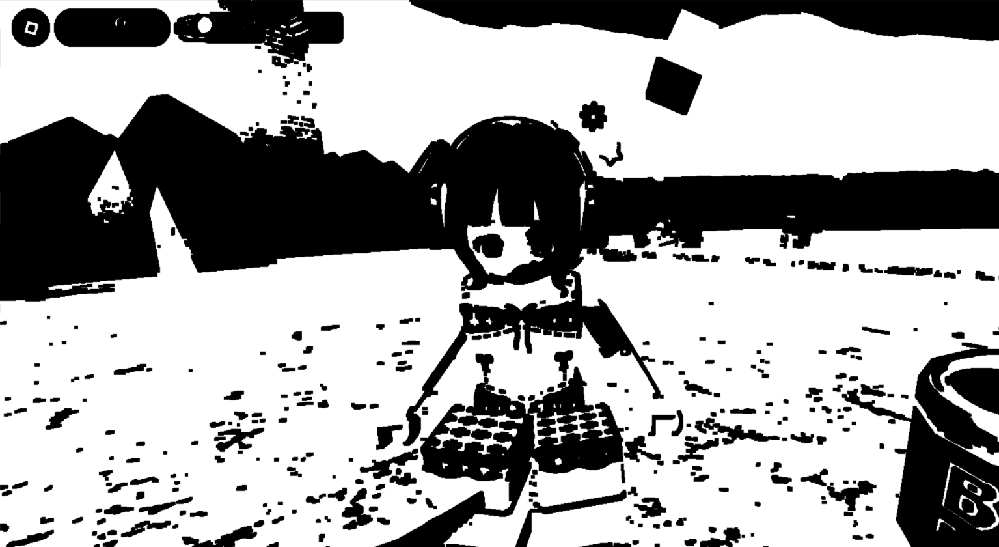
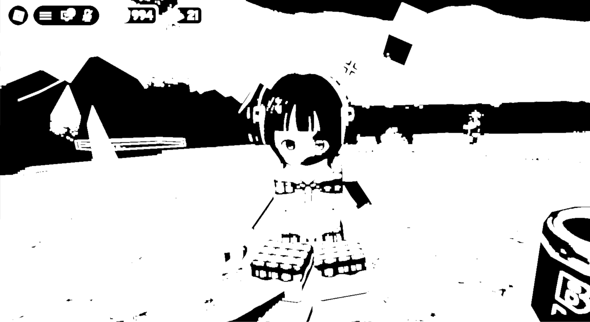
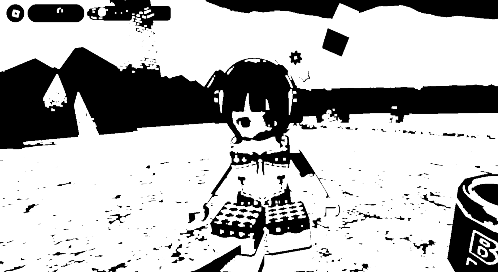
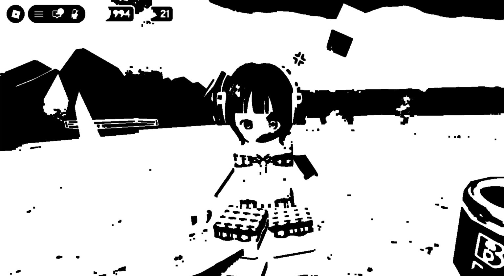
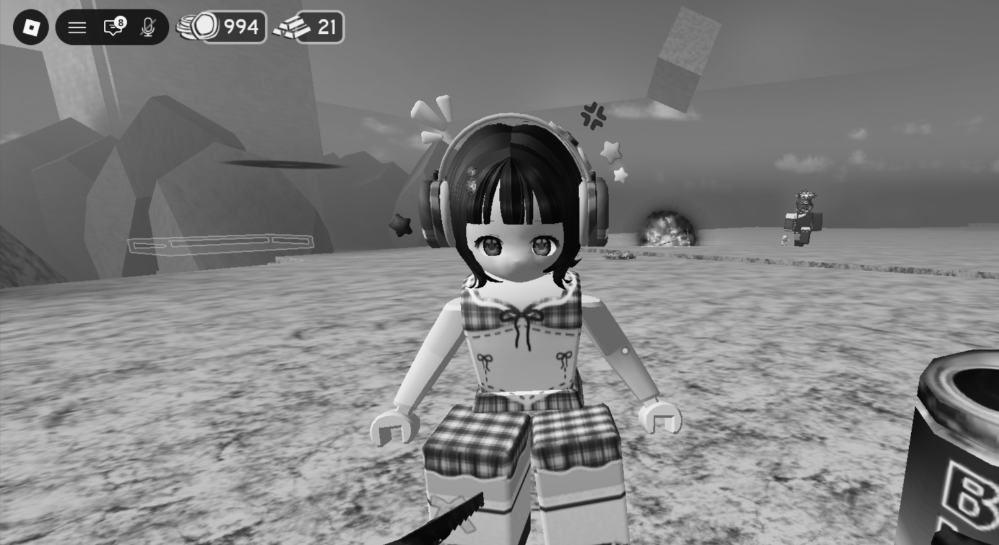
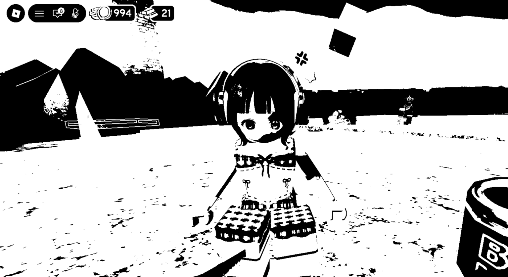

# Tugas 5 - Morphology

Tugas ini membahas penerapan **Morfologi Citra (*Image Morphology*)** pada pengolahan citra digital. Morfologi citra digunakan untuk menganalisis dan mengubah struktur bentuk objek pada citra, terutama citra biner.

Operasi morfologi memanfaatkan elemen struktur (*structuring element*) atau kernel untuk memeriksa hubungan antara piksel dan piksel di sekitarnya. Berdasarkan hubungan tersebut, bentuk objek dapat mengalami pengikisan, perluasan, penghilangan komponen kecil, atau penutupan celah.

Pada tugas ini, proses pengolahan citra meliputi:

- Grayscale
- Thresholding menggunakan metode Otsu
- Pembentukan kernel berukuran 5 × 5
- Erosi (*Erosion*)
- Dilasi (*Dilation*)
- Opening
- Closing

Tahap grayscale dan thresholding digunakan untuk menyiapkan citra sebelum operasi morfologi dilakukan. Selanjutnya, keempat operasi morfologi diterapkan pada citra biner untuk mengamati perubahan struktur objek.

---

## 1. Morfologi Citra (*Image Morphology*)

**Morfologi citra** merupakan teknik pengolahan citra yang berfokus pada bentuk dan struktur objek. Berbeda dengan transformasi intensitas yang mengubah nilai kecerahan piksel, morfologi citra mengubah struktur area berdasarkan hubungan spasial antara piksel-piksel di sekitarnya.

Morfologi banyak digunakan dalam pengolahan citra untuk menghilangkan noise, memperbaiki bentuk objek, menyambungkan bagian yang terputus, dan menutup celah kecil.

Operasi morfologi umumnya diterapkan pada citra biner. Pada citra biner, setiap piksel hanya memiliki dua kemungkinan nilai:

- `0` → hitam
- `255` → putih

Dalam pembahasan morfologi, terdapat istilah **foreground** dan **background**.

- **Foreground** merupakan bagian citra yang dianggap sebagai objek utama.
- **Background** merupakan bagian citra yang dianggap sebagai latar belakang.

Namun, foreground tidak selalu harus berwarna putih. Foreground dapat berupa hitam atau putih, bergantung pada hasil thresholding dan representasi citra yang digunakan.

Hal ini penting karena operasi morfologi pada OpenCV secara umum memperlakukan piksel putih (`255`) sebagai area aktif yang diproses, sedangkan piksel hitam (`0`) menjadi area di luarnya.

Pada citra yang digunakan dalam tugas ini, objek atau foreground terlihat berwarna hitam dan latar belakang atau background berwarna putih. Oleh karena itu, perubahan visual akibat erosi dan dilasi akan terlihat berlawanan dengan contoh yang menggunakan objek putih sebagai foreground.

## 2. Grayscale

Grayscale merupakan proses mengubah citra berwarna menjadi citra dengan satu kanal intensitas. Citra grayscale tidak lagi menyimpan informasi warna merah, hijau, dan biru secara terpisah, tetapi menyimpan tingkat keabuan setiap piksel.

Pada citra grayscale 8-bit, nilai intensitas berada dalam rentang 0 hingga 255:

- `0` menunjukkan hitam.
- `255` menunjukkan putih.
- Nilai di antara 0 dan 255 menunjukkan berbagai tingkat keabuan.

Konversi grayscale dapat dihitung menggunakan pendekatan luminans berikut:

$$
Gray = 0.299R + 0.587G + 0.114B
$$

Keterangan:

- `R` merupakan intensitas merah.
- `G` merupakan intensitas hijau.
- `B` merupakan intensitas biru.
- `Gray` merupakan nilai intensitas grayscale.

Bobot setiap kanal berbeda karena kontribusi warna terhadap persepsi kecerahan tidak sama. Kanal hijau memiliki bobot paling besar, diikuti merah dan biru.

Grayscale digunakan sebagai tahap awal karena thresholding dapat bekerja berdasarkan tingkat intensitas piksel. Dengan mengubah citra menjadi grayscale, pemisahan piksel berdasarkan kecerahan menjadi lebih sederhana.

Pada tahap ini, bentuk objek belum mengalami operasi morfologi. Perubahan yang dilakukan hanya mengubah representasi warna menjadi tingkat keabuan.

---

## 3. Thresholding

**Thresholding** merupakan proses mengubah citra grayscale menjadi citra biner dengan membandingkan intensitas setiap piksel terhadap nilai ambang (*threshold*).

Pada thresholding biner standar, aturan pemetaan intensitas dapat ditulis sebagai:

$$
B(x,y)=
\begin{cases}
255, & I(x,y)>T \\
0, & I(x,y)\leq T
\end{cases}
$$

Keterangan:

- `I(x,y)` adalah intensitas piksel pada koordinat `(x,y)`.
- `T` adalah nilai threshold.
- `B(x,y)` adalah nilai piksel pada citra biner.

Jika intensitas piksel lebih besar daripada ambang, piksel menjadi putih. Jika intensitasnya tidak lebih besar daripada ambang, piksel menjadi hitam.

### Metode Otsu

Pada tugas ini, thresholding menggunakan metode **Otsu**. Metode Otsu menentukan nilai threshold secara otomatis berdasarkan distribusi intensitas pada citra grayscale.

Secara umum, metode Otsu mencari nilai ambang yang memisahkan piksel menjadi dua kelompok intensitas sehingga variansi antarkelompok menjadi sebesar mungkin. Dengan kata lain, metode ini berusaha memperoleh pemisahan yang baik antara dua kelompok intensitas berdasarkan histogram citra.

Misalkan citra dibagi menjadi dua kelompok:

- Kelompok 0: piksel dengan intensitas pada sisi bawah threshold.
- Kelompok 1: piksel dengan intensitas pada sisi atas threshold.

Variansi antarkelompok dapat dinyatakan sebagai:

$$
\sigma_B^2(T)=
\omega_0(T)\omega_1(T)
\left[\mu_0(T)-\mu_1(T)\right]^2
$$

Keterangan:

- `T` adalah kandidat threshold.
- `ω₀` dan `ω₁` adalah proporsi piksel pada kedua kelompok.
- `μ₀` dan `μ₁` adalah rata-rata intensitas kedua kelompok.
- `σ²B` adalah variansi antarkelompok.

Metode Otsu memilih threshold yang memaksimalkan nilai variansi antarkelompok tersebut.

Hasil thresholding pada tugas ini menunjukkan objek berwarna hitam dan latar belakang berwarna putih. Hal ini berarti objek yang ingin diamati sebagai foreground direpresentasikan dengan nilai `0`, sedangkan area latar belakang direpresentasikan dengan nilai `255`.

**Catatan penting:** Otsu menentukan threshold berdasarkan distribusi intensitas, bukan berdasarkan pemahaman tentang objek. Karena itu, metode ini tidak selalu menghasilkan pemisahan foreground dan background yang sempurna. Hasilnya bergantung pada karakteristik gambar yang digunakan.

---

## 4. Kernel (*Structuring Element*)

Kernel atau *structuring element* merupakan pola kecil yang digunakan untuk memeriksa piksel dan lingkungan di sekitarnya ketika operasi morfologi dilakukan.

Kernel bergerak pada berbagai posisi citra. Pada setiap posisi, nilai piksel di sekitar titik yang diperiksa digunakan untuk menentukan apakah bagian citra akan dipertahankan, dikikis, atau diperluas.

Pada tugas ini digunakan kernel persegi berukuran 5 × 5.

Bentuk kernel secara sederhana dapat digambarkan sebagai:

$$
K=
\begin{bmatrix}
1&1&1&1&1\\
1&1&1&1&1\\
1&1&1&1&1\\
1&1&1&1&1\\
1&1&1&1&1
\end{bmatrix}
$$

Kernel tersebut memiliki 25 elemen aktif. Bentuk persegi membuat pemrosesan dilakukan dengan memperhatikan area tetangga di sekitar posisi yang sedang diperiksa.

### Pengaruh ukuran kernel

Ukuran kernel memengaruhi seberapa kuat perubahan morfologi yang dihasilkan.

- Kernel kecil cenderung menghasilkan perubahan yang lebih terbatas.
- Kernel besar cenderung menghasilkan perubahan struktur yang lebih kuat.
- Kernel yang berbeda bentuk dapat menghasilkan perubahan pada arah atau pola tertentu.

Kernel 5 × 5 yang digunakan pada tugas ini memiliki ukuran sedang untuk mengamati perubahan struktur objek pada operasi erosi, dilasi, opening, dan closing.

Kernel bukanlah gambar yang ditambahkan ke citra. Kernel merupakan elemen struktur yang menentukan hubungan spasial yang digunakan selama proses morfologi.

---

## 5. Erosi (*Erosion*)

**Erosi** merupakan operasi morfologi yang mengikis atau memperkecil area aktif pada citra. Operasi ini memeriksa apakah elemen struktur dapat ditempatkan pada suatu area tanpa melanggar kondisi piksel yang diperlukan.

Pada citra biner yang menggunakan putih sebagai foreground, erosi akan mengikis batas objek putih. Bagian tepi objek akan menyusut karena piksel di dekat batas tidak lagi memenuhi kondisi yang dibutuhkan oleh kernel.

Secara matematis, erosi terhadap himpunan citra `A` dengan elemen struktur `B` dapat ditulis sebagai:

$$
A \ominus B
=
\{x \mid B_x \subseteq A\}
$$

Keterangan:

- `A` adalah himpunan piksel foreground.
- `B` adalah elemen struktur atau kernel.
- `Bₓ` adalah kernel yang ditempatkan pada posisi `x`.
- `⊖` merupakan operator erosi.

Persamaan tersebut berarti suatu posisi dipertahankan sebagai bagian foreground apabila elemen struktur pada posisi itu seluruhnya berada di dalam foreground.

### Mekanisme kerja erosi

Secara sederhana, proses erosi pada citra biner dengan foreground putih dapat dipahami sebagai berikut:

1. Kernel ditempatkan pada suatu posisi citra.
2. Piksel dan area tetangganya diperiksa.
3. Jika area di sekitar posisi tersebut tidak memenuhi kondisi foreground yang dibutuhkan oleh kernel, posisi itu tidak dipertahankan sebagai foreground.
4. Proses diulang pada berbagai posisi citra.
5. Area foreground yang berada di bagian tepi akan terkikis sehingga bentuk objek menyusut.

Erosi dapat digunakan untuk mengurangi komponen foreground yang kecil, mengikis tonjolan pada batas objek, dan memisahkan objek yang saling terhubung melalui bagian yang tipis.

### Erosi pada citra tugas ini

Pada hasil thresholding tugas ini, foreground berupa objek hitam dan background berupa area putih. Sementara itu, operasi morfologi OpenCV memproses piksel putih sebagai area aktif.

Akibatnya, erosi mengikis area putih yang menjadi bagian aktif operasi. Area putih di sekitar objek menyusut sehingga batas objek hitam dapat terlihat meluas.

Dengan demikian, **hasil erosi pada tugas ini menunjukkan area hitam yang cenderung membesar**, bukan mengecil seperti pada contoh yang menggunakan foreground putih.



---

## 6. Dilasi (*Dilation*)

**Dilasi** merupakan operasi morfologi yang memperluas area aktif pada citra. Operasi ini memperbesar bagian foreground dengan mempertimbangkan area tetangga berdasarkan kernel.

Pada citra biner dengan foreground putih, dilasi akan memperluas area putih. Piksel putih dapat bertambah di sekitar batas objek sehingga objek tampak lebih besar.

Secara matematis, dilasi dapat ditulis sebagai:

$$
A \oplus B
=
\{x \mid (\hat{B})_x \cap A \neq \varnothing\}
$$

Keterangan:

- `A` adalah himpunan piksel foreground.
- `B` adalah elemen struktur.
- `B̂` merupakan elemen struktur yang direfleksikan.
- `⊕` merupakan operator dilasi.
- `∩` menyatakan irisan himpunan.

Persamaan tersebut menggambarkan bahwa posisi dapat menjadi bagian foreground jika elemen struktur yang ditempatkan pada posisi itu beririsan dengan foreground yang ada.

Untuk kernel persegi simetris seperti kernel 5 × 5 pada tugas ini, proses dilasi secara intuitif memperluas area putih ke daerah tetangga di sekitarnya.

### Mekanisme kerja dilasi

Secara sederhana, dilasi pada citra biner dengan foreground putih dapat dipahami sebagai berikut:

1. Kernel ditempatkan pada suatu posisi citra.
2. Area piksel di sekitar posisi tersebut diperiksa.
3. Jika terdapat piksel foreground di dalam area kernel, posisi yang bersangkutan dapat menjadi bagian foreground.
4. Proses diulang pada berbagai posisi citra.
5. Area foreground bertambah sehingga objek putih terlihat meluas.

Dilasi dapat digunakan untuk menyambungkan bagian objek yang terputus dalam jarak kecil, memperbesar area objek, dan mengurangi celah sempit di antara bagian foreground.

### Dilasi pada citra tugas ini

Pada citra tugas ini, area putih merupakan background dari objek yang diamati, tetapi menjadi area aktif yang diproses oleh OpenCV.

Dilasi memperluas area putih di sekitar objek. Akibatnya, batas objek hitam terdorong ke dalam dan area hitam dapat terlihat menyusut.

Dengan demikian, **hasil dilasi pada tugas ini menunjukkan area hitam yang cenderung mengecil**, berlawanan dengan hasil erosi.



---

## 7. Opening

**Opening** merupakan operasi morfologi yang menggabungkan erosi dan dilasi secara berurutan. Operasi ini dilakukan dengan menerapkan erosi terlebih dahulu, kemudian dilasi menggunakan elemen struktur yang sama.

Rumus opening dapat ditulis sebagai:

$$
A \circ B=(A\ominus B)\oplus B
$$

Keterangan:

- `A` adalah citra atau himpunan foreground.
- `B` adalah elemen struktur.
- `⊖` merupakan erosi.
- `⊕` merupakan dilasi.
- `∘` merupakan operator opening.

### Mekanisme kerja opening

Opening dilakukan melalui dua tahap.

**Tahap pertama: erosi**

Erosi mengikis bagian tepi area foreground. Komponen kecil atau tonjolan yang ukurannya tidak cukup untuk mempertahankan struktur setelah erosi dapat dihilangkan.

**Tahap kedua: dilasi**

Setelah erosi selesai, dilasi diterapkan untuk memperbesar kembali bagian foreground yang tersisa. Langkah ini membantu mengembalikan ukuran bagian utama objek tanpa selalu mengembalikan komponen kecil yang sudah hilang pada tahap erosi.

Oleh karena itu, opening umumnya digunakan untuk menghilangkan noise kecil, mengurangi tonjolan, dan memperbaiki bentuk objek tanpa mempertahankan semua detail kecil yang tidak sesuai dengan ukuran kernel.

### Opening pada citra tugas ini

Secara konseptual, opening biasanya dijelaskan dengan menganggap objek putih sebagai foreground. Namun, pada citra tugas ini, objek yang diamati berwarna hitam dan area putih merupakan background.

Operasi opening OpenCV tetap bekerja terhadap area putih sebagai area aktif. Karena itu, interpretasi hasilnya harus memperhatikan warna area yang sedang diproses, bukan hanya menganggap bahwa objek hitam akan mengikuti efek opening pada foreground putih.

Pada citra ini, opening dapat menghilangkan atau mengubah komponen putih yang kecil, kemudian memperbesar kembali bagian putih yang bertahan setelah erosi. Efek akhirnya terhadap objek hitam bergantung pada bentuk, ukuran, dan susunan piksel pada citra.



---

## 8. Closing

**Closing** merupakan operasi morfologi yang menggabungkan dilasi dan erosi secara berurutan. Operasi ini merupakan urutan kebalikan dari opening, yaitu dilasi terlebih dahulu, kemudian erosi.

Rumus closing dapat ditulis sebagai:

$$
A \bullet B=(A\oplus B)\ominus B
$$

Keterangan:

- `A` adalah citra atau himpunan foreground.
- `B` adalah elemen struktur.
- `⊕` merupakan dilasi.
- `⊖` merupakan erosi.
- `•` merupakan operator closing.

### Mekanisme kerja closing

Closing dilakukan melalui dua tahap.

**Tahap pertama: dilasi**

Dilasi memperluas area foreground. Celah sempit atau lubang kecil yang berada di dalam maupun di antara bagian foreground dapat tertutup apabila ukurannya sesuai dengan elemen struktur.

**Tahap kedua: erosi**

Setelah dilasi, erosi diterapkan untuk mengurangi kembali ukuran area foreground. Tahap ini membantu mempertahankan ukuran umum objek sambil menjaga sebagian celah kecil yang telah tertutup.

Closing umumnya digunakan untuk menutup lubang kecil, menyambungkan bagian yang terpisah oleh celah sempit, dan memperbaiki struktur objek yang memiliki gangguan kecil pada batasnya.

### Closing pada citra tugas ini

Pada tugas ini, operasi closing OpenCV diterapkan pada citra biner yang memiliki objek hitam dan background putih. Karena area putih diproses sebagai foreground aktif oleh operasi OpenCV, closing bekerja untuk mengubah struktur area putih tersebut.

Dilasi pada tahap pertama memperluas area putih, lalu erosi pada tahap kedua mengikis kembali area putih. Akibatnya, efek yang terlihat pada objek hitam dapat berbeda dari penjelasan closing yang menggunakan foreground putih.

Perubahan yang dihasilkan bergantung pada bentuk objek, ukuran celah, dan kernel yang digunakan.



---

## 9. Perbedaan Erosi, Dilasi, Opening, dan Closing

Keempat operasi morfologi memiliki mekanisme yang berbeda meskipun semuanya menggunakan elemen struktur untuk memproses area citra.

| Operasi | Mekanisme | Tujuan umum |
|---|---|---|
| Erosi | Mengikis area foreground aktif | Mengurangi ukuran objek dan menghilangkan bagian kecil |
| Dilasi | Memperluas area foreground aktif | Memperbesar objek dan menyambungkan bagian berdekatan |
| Opening | Erosi dilanjutkan dengan dilasi | Mengurangi komponen kecil dan tonjolan |
| Closing | Dilasi dilanjutkan dengan erosi | Menutup celah kecil dan lubang |

Perbedaan urutan pada opening dan closing menghasilkan efek yang berbeda. Opening menghilangkan bagian kecil yang tidak bertahan setelah erosi, sedangkan closing dapat menutup celah kecil melalui dilasi sebelum mengembalikan ukuran area melalui erosi.

### Mengapa hasil erosi dan dilasi terlihat terbalik?

Pada banyak contoh morfologi, objek atau foreground ditampilkan berwarna putih dan background berwarna hitam. Dalam kondisi tersebut, erosi membuat objek putih mengecil, sedangkan dilasi membuat objek putih membesar.

Pada tugas ini, hasil thresholding menampilkan objek hitam dan background putih. OpenCV tetap memproses area putih sebagai area aktif pada operasi morfologi.

Akibatnya:

- **Erosi:** area putih menyusut sehingga area hitam dapat terlihat membesar.
- **Dilasi:** area putih membesar sehingga area hitam dapat terlihat mengecil.

Jadi, hasil yang terlihat bukan berarti operasi erosi dan dilasi tertukar. Perbedaan tersebut muncul karena area yang diamati sebagai objek berwarna hitam, sedangkan area aktif yang diproses oleh operasi morfologi berwarna putih.

---

## 10. Visualisasi Hasil

Bagian ini menampilkan hasil setiap tahap pengolahan citra mulai dari gambar asli hingga operasi morfologi. Seluruh gambar disimpan dalam folder `image/`.

### Gambar Asli


Gambar asli merupakan masukan sebelum dilakukan proses pengolahan. Pada tahap ini, gambar masih memiliki informasi warna aslinya.

### Grayscale



Gambar grayscale hanya menyimpan informasi intensitas. Tahap ini digunakan untuk mempersiapkan gambar sebelum thresholding dilakukan.

### Citra Biner



Citra biner memiliki dua nilai piksel, yaitu hitam dan putih. Pada hasil yang digunakan dalam tugas ini, objek terlihat hitam dan background terlihat putih. Representasi ini menjadi dasar untuk operasi morfologi selanjutnya.

### Erosi


Erosi mengikis area putih yang diproses oleh OpenCV. Akibatnya, objek hitam pada citra dapat terlihat meluas karena area putih di sekelilingnya menyusut.

### Dilasi


Dilasi memperluas area putih yang diproses oleh OpenCV. Akibatnya, objek hitam dapat terlihat menyusut karena area putih mengambil sebagian area di sekeliling objek.

### Opening


Opening menggabungkan erosi dan dilasi. Perubahan struktur yang dihasilkan bergantung pada bagian area yang bertahan setelah erosi dan bagaimana bagian tersebut berkembang kembali setelah dilasi.

### Closing


Closing menggabungkan dilasi dan erosi. Operasi ini dapat mengubah celah dan lubang kecil pada area yang diproses. Karena foreground objek yang diamati berwarna hitam, perubahan akhirnya perlu dibandingkan dengan citra biner awal.

---

## 11. Analisis Hasil

Berdasarkan hasil pengolahan citra, perubahan yang terjadi dapat dijelaskan melalui mekanisme setiap tahap.

### Grayscale dan thresholding

Grayscale menyederhanakan informasi warna menjadi satu nilai intensitas pada setiap piksel. Tahap ini memungkinkan pemisahan piksel berdasarkan kecerahan.

Thresholding kemudian mengelompokkan piksel menjadi hitam dan putih. Metode Otsu menentukan ambang berdasarkan distribusi intensitas sehingga nilai threshold tidak harus ditentukan secara manual.

Walaupun demikian, hasil thresholding tidak selalu memisahkan objek dan latar belakang secara sempurna. Apabila intensitas objek dan background saling tumpang tindih, sebagian piksel dapat dikelompokkan ke area yang tidak diharapkan.

### Erosi dan dilasi

Erosi dan dilasi merupakan dua operasi dasar yang memiliki efek berlawanan terhadap area aktif.

Erosi mengikis area putih, sedangkan dilasi memperluas area putih. Karena objek yang diamati pada tugas ini berwarna hitam, hasilnya terlihat terbalik jika dibandingkan dengan contoh yang menggunakan foreground putih.

Perubahan tersebut menunjukkan bahwa interpretasi hasil morfologi harus mempertimbangkan representasi citra biner. Warna yang dianggap sebagai objek oleh pengamat belum tentu merupakan area aktif yang diproses oleh operasi morfologi.

### Opening dan closing

Opening dan closing menggabungkan kedua operasi dasar dengan urutan berbeda.

Opening menerapkan erosi terlebih dahulu untuk menghilangkan komponen kecil, kemudian dilasi untuk memperbesar kembali area yang bertahan. Closing menerapkan dilasi terlebih dahulu untuk memperluas area, kemudian erosi untuk mengurangi kembali ukurannya.

Keduanya tidak selalu menghasilkan perubahan yang terlihat jelas. Efeknya bergantung pada ukuran dan bentuk komponen, lebar celah, serta ukuran kernel. Jika detail yang ada jauh lebih besar daripada kernel, perubahan mungkin relatif kecil. Sebaliknya, komponen atau celah yang berukuran sebanding dengan kernel dapat mengalami perubahan yang lebih terlihat.

### Pengaruh kernel 5 × 5

Kernel menentukan area tetangga yang diperiksa selama operasi morfologi. Kernel 5 × 5 mencakup area yang lebih luas daripada kernel 3 × 3 sehingga dapat memberikan perubahan yang lebih kuat terhadap batas objek dan komponen kecil.

Namun, ukuran kernel yang lebih besar tidak selalu menghasilkan hasil yang lebih baik. Kernel yang terlalu besar dapat menghilangkan detail penting, menutup celah yang seharusnya dipertahankan, atau mengubah bentuk objek secara berlebihan.

Dengan demikian, pemilihan kernel perlu disesuaikan dengan ukuran objek dan detail yang ingin dipertahankan.

---

## 12. Struktur Folder

Struktur folder project disusun sebagai berikut:

```text
5-morphology/
├── README.md
├── 5-morphology.py
├── rb.png
└── image/
    ├── 1.png
    ├── 2.png
    ├── 3.png
    ├── 4.png
    ├── 5.png
    ├── 6.png
    └── 7.png
```

Keterangan:

- `README.md` berisi dokumentasi teori, mekanisme metode, visualisasi, dan analisis hasil.
- `5-morphology.py` merupakan program Python yang menjalankan pengolahan citra.
- `rb.png` merupakan gambar masukan.
- Folder `image/` menyimpan gambar hasil untuk ditampilkan pada README GitHub.

Nama file dan susunan folder perlu sesuai dengan tautan gambar yang digunakan dalam README agar semua visualisasi dapat ditampilkan dengan benar di GitHub.

---

## 13. Instalasi Library

Program ini menggunakan Python dan OpenCV untuk membaca gambar, mengubah citra menjadi grayscale, melakukan thresholding, serta menjalankan operasi morfologi.

Library dapat dipasang menggunakan perintah berikut:

```bash
pip install opencv-python numpy
```

OpenCV menyediakan fungsi pengolahan citra yang digunakan pada program, sedangkan NumPy merupakan library pendukung untuk pengolahan data numerik.

---

## 14. Cara Menjalankan Program

Jalankan program melalui terminal pada folder project:

```bash
python 5-morphology.py
```

Program akan menampilkan tujuh visualisasi secara terpisah:

1. Gambar asli
2. Grayscale
3. Citra biner
4. Erosi
5. Dilasi
6. Opening
7. Closing

Setiap jendela dapat digunakan untuk membandingkan perubahan citra dari satu tahap ke tahap lainnya. Untuk melihat efek morfologi dengan benar, bandingkan hasil erosi, dilasi, opening, dan closing dengan citra biner awal.

---

## Kesimpulan

Morfologi citra merupakan teknik pengolahan citra digital yang berfokus pada perubahan bentuk dan struktur objek. Pada tugas ini, proses dimulai dengan konversi grayscale dan thresholding untuk menghasilkan citra biner, kemudian dilanjutkan dengan operasi erosi, dilasi, opening, dan closing menggunakan kernel persegi berukuran 5 × 5.

Erosi bekerja dengan mengikis area foreground aktif, sedangkan dilasi memperluasnya. Opening merupakan gabungan erosi dan dilasi yang umumnya digunakan untuk menghilangkan komponen kecil, sedangkan closing menggabungkan dilasi dan erosi untuk menutup celah atau lubang kecil.

Hasil tugas ini juga menunjukkan pentingnya memahami representasi foreground dan background. Karena objek pada citra biner yang digunakan berwarna hitam dan background berwarna putih, erosi membuat area hitam terlihat meluas dan dilasi membuat area hitam terlihat menyusut. Hal tersebut terjadi karena OpenCV memproses area putih sebagai area aktif pada operasi morfologi.

Melalui tugas ini, dapat dipahami bahwa hasil operasi morfologi tidak hanya bergantung pada jenis operasi, tetapi juga pada representasi citra biner, ukuran kernel, serta bentuk dan ukuran objek yang diproses.
